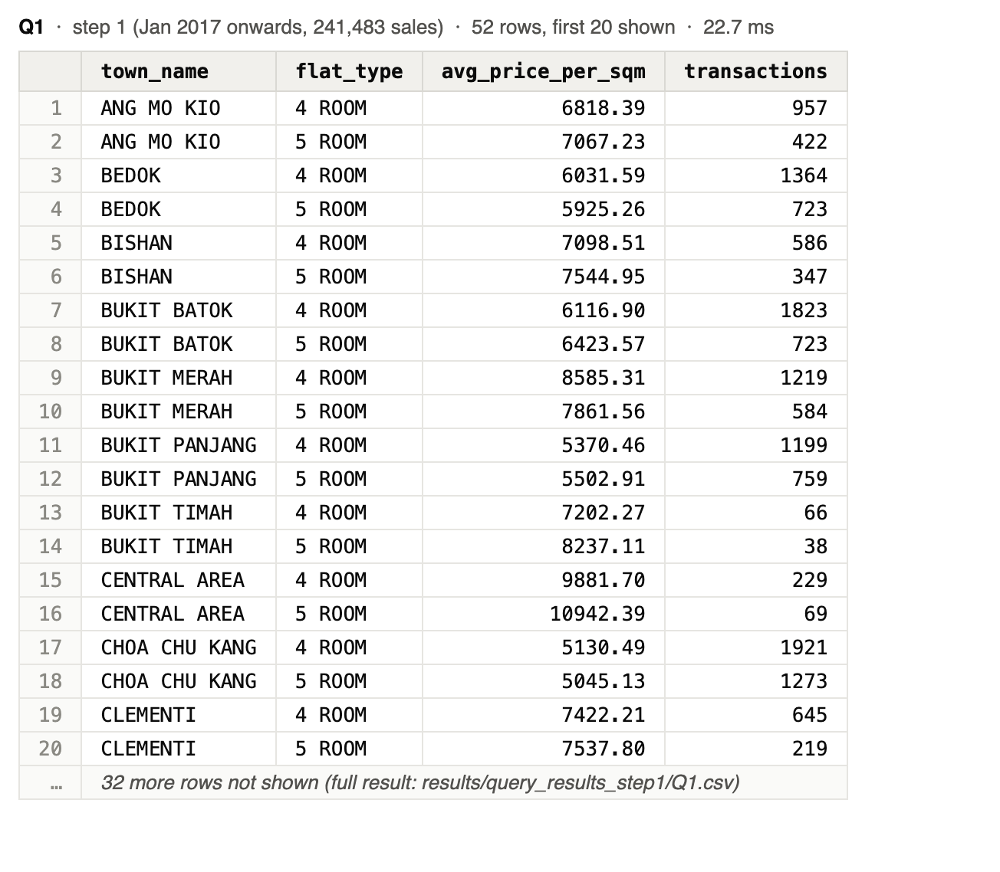
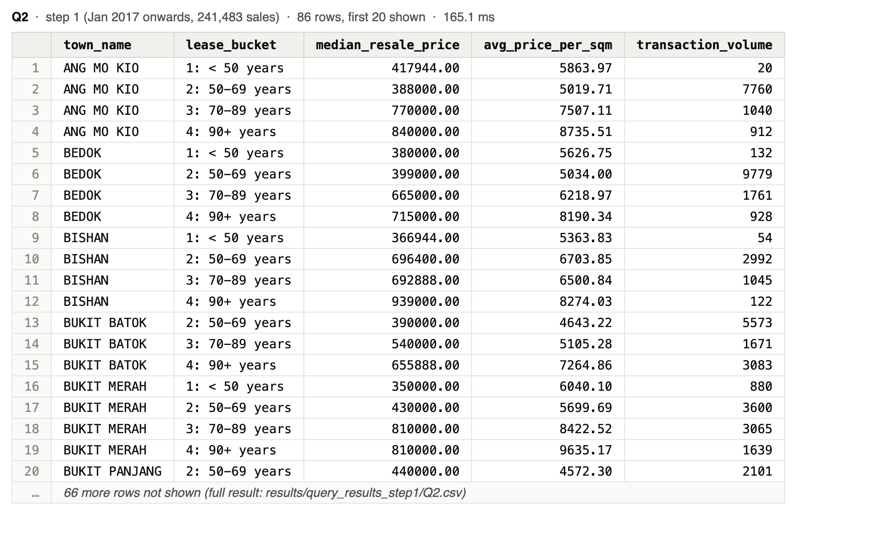
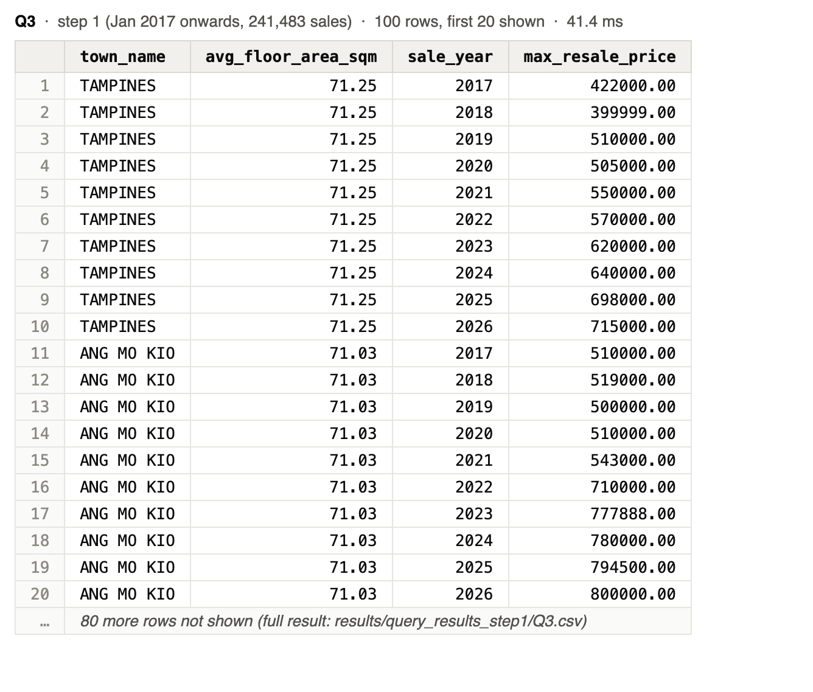
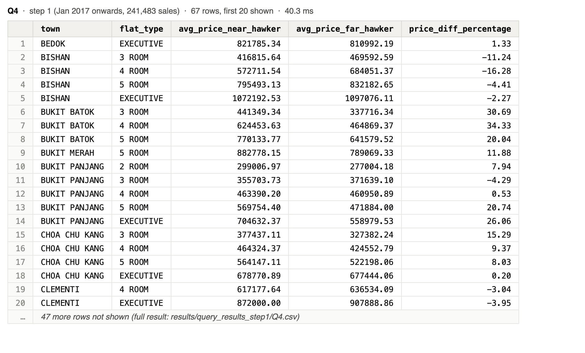
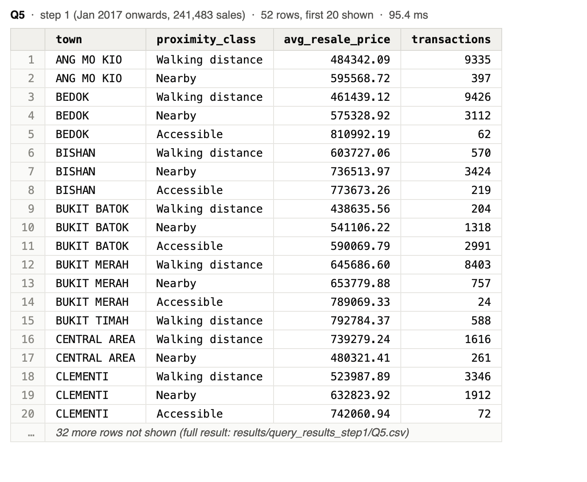
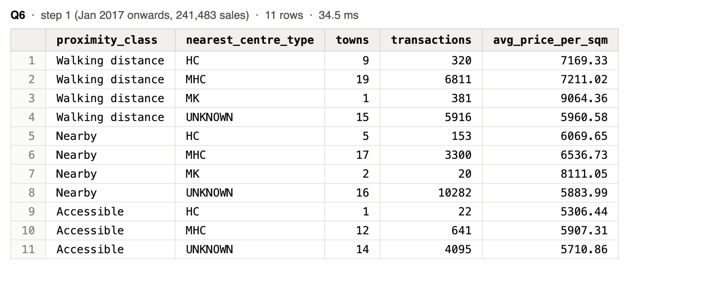
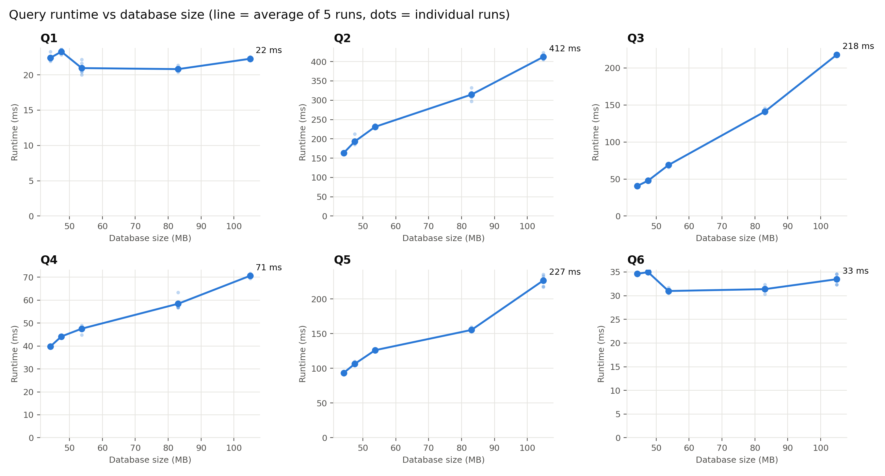

# Task 3 findings

## Setup

We loaded the Jan 2017 onwards file first (241,483 sales), then added one older file per step up to 987,686 sales. Results and insights use step 1, since later steps mix prices from 1990 to 2026 without inflation adjustment.

## Queries, results and insights

Images show the first 20 rows; full results are in `results/query_results_step1/`.

### Q1: Price per square metre across towns

```sql
-- Price per square metre across towns: average price per m2 of 4-room and
-- 5-room flats sold in the 3-year range 2022-2024, per town and flat type.
SELECT t.town_name,
       f.flat_type,
       ROUND(AVG(rt.resale_price / f.floor_area_sqm), 2) AS avg_price_per_sqm,
       COUNT(*)                                          AS transactions
FROM housing.resale_transaction rt
JOIN housing.hdb_flat     f ON f.flat_id     = rt.flat_id
JOIN housing.hdb_building b ON b.building_id = f.building_id
JOIN housing.town         t ON t.town_id     = b.town_id
WHERE f.flat_type IN ('4 ROOM', '5 ROOM')
  AND rt.transaction_month >= DATE '2022-01-01'
  AND rt.transaction_month <  DATE '2025-01-01'
GROUP BY t.town_name, f.flat_type
ORDER BY t.town_name, f.flat_type;
```



Insight: Price per m² for 4- and 5-room flats sold in 2022–2024 is almost twice as high in Central Area (9,882) and Queenstown (9,353) as in Choa Chu Kang (5,130). 5-room flats cost more per m² than 4-room flats in only 10 of 26 towns.

### Q2: Remaining lease vs transaction price

```sql
-- Remaining lease vs transaction price: per town and remaining-lease bucket,
-- the median resale price, average price per m2 and number of sales.
WITH sale AS (
    SELECT t.town_name,
           rt.resale_price,
           rt.resale_price / f.floor_area_sqm AS price_per_sqm,
           99 - (EXTRACT(YEAR FROM rt.transaction_month)::int - f.lease_commence_year) AS remaining_lease_years
    FROM housing.resale_transaction rt
    JOIN housing.hdb_flat     f ON f.flat_id     = rt.flat_id
    JOIN housing.hdb_building b ON b.building_id = f.building_id
    JOIN housing.town         t ON t.town_id     = b.town_id
),
bucketed AS (
    SELECT town_name, resale_price, price_per_sqm,
           CASE
               WHEN remaining_lease_years < 50 THEN '1: < 50 years'
               WHEN remaining_lease_years < 70 THEN '2: 50-69 years'
               WHEN remaining_lease_years < 90 THEN '3: 70-89 years'
               ELSE                                 '4: 90+ years'
           END AS lease_bucket
    FROM sale
)
SELECT town_name,
       lease_bucket,
       percentile_cont(0.5) WITHIN GROUP (ORDER BY resale_price) AS median_resale_price,
       ROUND(AVG(price_per_sqm), 2)                              AS avg_price_per_sqm,
       COUNT(*)                                                  AS transaction_volume
FROM bucketed
GROUP BY town_name, lease_bucket
ORDER BY town_name, lease_bucket;
```



Insight: In 19 of 20 towns with both buckets, flats with 90+ years of lease left sell at a higher median price than those with 50–69 years; the under-50 bucket is too small to judge.

### Q3: Resale price for towns with large flats

```sql
-- Resale price for towns with large flats: the 10 towns with the highest
-- average floor area of 3-room flats sold, and for each of them the highest
-- 3-room resale price in every year.
WITH three_room AS (
    SELECT t.town_name,
           EXTRACT(YEAR FROM rt.transaction_month)::int AS sale_year,
           f.floor_area_sqm,
           rt.resale_price
    FROM housing.resale_transaction rt
    JOIN housing.hdb_flat     f ON f.flat_id     = rt.flat_id
    JOIN housing.hdb_building b ON b.building_id = f.building_id
    JOIN housing.town         t ON t.town_id     = b.town_id
    WHERE f.flat_type = '3 ROOM'
),
top_towns AS (
    SELECT town_name, ROUND(AVG(floor_area_sqm), 2) AS avg_floor_area_sqm
    FROM three_room
    GROUP BY town_name
    ORDER BY avg_floor_area_sqm DESC, town_name
    LIMIT 10
)
SELECT tt.town_name,
       tt.avg_floor_area_sqm,
       r.sale_year,
       MAX(r.resale_price) AS max_resale_price
FROM top_towns tt
JOIN three_room r ON r.town_name = tt.town_name
GROUP BY tt.town_name, tt.avg_floor_area_sqm, r.sale_year
ORDER BY tt.avg_floor_area_sqm DESC, tt.town_name, r.sale_year;
```



Insight: The ten towns with the largest 3-room flats differ by less than 3 m² on average. Their top prices rose 18–81% between 2017 and 2026, mostly from 2021 on.

### Q4: Hawker centre proximity effect

```sql
-- Hawker centre proximity effect: average resale price of flats whose nearest
-- hawker centre is in the closest class (level 1, < 800 m walking) vs the
-- furthest class (level 3, 1,600-2,400 m), per town and flat type.
-- Only (town, flat type) groups with sales in both classes are returned.
WITH nearest AS (
    SELECT building_id, MIN(distance_m) AS nearest_m
    FROM housing.proximity
    GROUP BY building_id
),
sale AS (
    SELECT t.town_name, f.flat_type, l.level_id, rt.resale_price
    FROM housing.resale_transaction rt
    JOIN housing.hdb_flat        f ON f.flat_id     = rt.flat_id
    JOIN housing.hdb_building    b ON b.building_id = f.building_id
    JOIN housing.town            t ON t.town_id     = b.town_id
    JOIN nearest                 n ON n.building_id = b.building_id
    JOIN housing.proximity_level l ON n.nearest_m >= l.min_dist_m AND n.nearest_m < l.max_dist_m
),
by_class AS (
    SELECT town_name, flat_type,
           AVG(resale_price) FILTER (WHERE level_id = 1) AS avg_near,
           AVG(resale_price) FILTER (WHERE level_id = 3) AS avg_far
    FROM sale
    GROUP BY town_name, flat_type
)
SELECT town_name                                    AS town,
       flat_type,
       ROUND(avg_near, 2)                           AS avg_price_near_hawker,
       ROUND(avg_far, 2)                            AS avg_price_far_hawker,
       ROUND((avg_near - avg_far) * 100 / avg_far, 2) AS price_diff_percentage
FROM by_class
WHERE avg_near IS NOT NULL
  AND avg_far  IS NOT NULL
ORDER BY town, flat_type;
```



Insight: Near flats cost more than far ones in 42 of 67 town and flat-type groups and less in 25 (median gap +3%), so we cannot conclude that hawker proximity raises prices.

### Q5: Town-level price near fresh-market hawkers

```sql
-- Town-level price near fresh-market hawkers: for flats near a hawker centre
-- with market produce stalls, the average resale price per proximity class of
-- the nearest such centre. Only towns whose overall average price for these
-- flats exceeds the budget of SGD 450,000 are returned. The budget was chosen
-- so the result is neither empty nor all towns at every database size (1-5).
WITH nearest_market AS (
    SELECT p.building_id, MIN(p.distance_m) AS nearest_m
    FROM housing.proximity p
    JOIN housing.hawker_centre h ON h.hawker_id = p.hawker_id
    WHERE h.market_produce_stalls > 0
    GROUP BY p.building_id
),
sale AS (
    SELECT t.town_name, l.level_id, l.label AS proximity_class, rt.resale_price
    FROM nearest_market nm
    JOIN housing.proximity_level    l  ON nm.nearest_m >= l.min_dist_m AND nm.nearest_m < l.max_dist_m
    JOIN housing.hdb_building       b  ON b.building_id = nm.building_id
    JOIN housing.town               t  ON t.town_id     = b.town_id
    JOIN housing.hdb_flat           f  ON f.building_id = b.building_id
    JOIN housing.resale_transaction rt ON rt.flat_id    = f.flat_id
),
towns_over_budget AS (
    SELECT town_name
    FROM sale
    GROUP BY town_name
    HAVING AVG(resale_price) > 450000
)
SELECT s.town_name                  AS town,
       s.proximity_class,
       ROUND(AVG(s.resale_price), 2) AS avg_resale_price,
       COUNT(*)                     AS transactions
FROM sale s
JOIN towns_over_budget o ON o.town_name = s.town_name
GROUP BY s.town_name, s.level_id, s.proximity_class
ORDER BY town, s.level_id;
```



Insight: With a SGD 450,000 budget, 20 of 22 towns near a fresh-market centre pass. In 12 of 17 towns with walking-distance flats and another class, the walking-distance class is cheapest, likely because these centres sit in older estates.

Budget change: we first set SGD 600,000. It returned 5 or 6 towns at steps 1 to 3 but no rows at steps 4 and 5, where older, cheaper sales pull every town's average below it. We lowered it to 450,000 (2 to 20 towns at every step) and reran all five steps so every measurement uses the same query.

### Q6: Own query (joins all 7 tables): type of the nearest hawker centre

```sql
-- Own query, joins all 7 tables: does the TYPE of the nearest hawker centre
-- matter? For 4-room flats sold 2022-2024, the average price per m2 by the
-- proximity class and type of the nearest centre (HC = hawker centre,
-- MHC = market & hawker centre, MK = market; UNKNOWN = not in the NEA list).
WITH nearest AS (
    SELECT DISTINCT ON (building_id) building_id, hawker_id, distance_m
    FROM housing.proximity
    ORDER BY building_id, distance_m, hawker_id
)
SELECT l.label                                           AS proximity_class,
       COALESCE(h.centre_type, 'UNKNOWN')                AS nearest_centre_type,
       COUNT(DISTINCT t.town_id)                         AS towns,
       COUNT(*)                                          AS transactions,
       ROUND(AVG(rt.resale_price / f.floor_area_sqm), 2) AS avg_price_per_sqm
FROM housing.resale_transaction rt
JOIN housing.hdb_flat        f ON f.flat_id     = rt.flat_id
JOIN housing.hdb_building    b ON b.building_id = f.building_id
JOIN housing.town            t ON t.town_id     = b.town_id
JOIN nearest                 n ON n.building_id = b.building_id
JOIN housing.hawker_centre   h ON h.hawker_id   = n.hawker_id
JOIN housing.proximity_level l ON n.distance_m >= l.min_dist_m AND n.distance_m < l.max_dist_m
WHERE f.flat_type = '4 ROOM'
  AND rt.transaction_month >= DATE '2022-01-01'
  AND rt.transaction_month <  DATE '2025-01-01'
GROUP BY l.level_id, l.label, COALESCE(h.centre_type, 'UNKNOWN')
ORDER BY l.level_id, nearest_centre_type;
```



Insight: For 4-room flats sold in 2022–2024, price per m² near a market and hawker centre falls from 7,211 (walking distance) to 5,907 (accessible).

## Performance measurements

Average of 5 runs per size, in ms:

| Step | Sales | DB (MB) | Q1 | Q2 | Q3 | Q4 | Q5 | Q6 |
|---|---|---|---|---|---|---|---|---|
| 1 | 241,483 | 44.2 | 22.4 | 163.4 | 40.5 | 39.8 | 93.4 | 34.6 |
| 2 | 278,636 | 47.5 | 23.3 | 193.0 | 47.8 | 44.2 | 106.4 | 35.0 |
| 3 | 330,839 | 53.7 | 21.0 | 231.1 | 68.9 | 47.6 | 126.1 | 31.0 |
| 4 | 700,490 | 83.0 | 20.8 | 314.7 | 141.1 | 58.4 | 155.3 | 31.4 |
| 5 | 987,686 | 104.9 | 22.3 | 412.2 | 217.8 | 70.6 | 226.6 | 33.5 |



Q1 and Q6 stay flat because they filter on 2022–2024 and PostgreSQL scans the transactions in parallel. Q3 grows fastest (5.4 times for 4.1 times more sales): its `WITH` subquery is used twice, so it is materialised and runs without parallel workers. Q2's median sort spills to disk past the 4 MB `work_mem`. Q4 and Q5 grow more slowly than the data. Q2 and Q3 are the first candidates for Task 4 indexes.

## Supplementary files

| File | Content |
|---|---|
| `queries.sql` | Executable SQL for Q1–Q6 |
| `results/task3_measurements.csv` | Raw measurements: 150 rows (6 queries × 5 runs × 5 sizes) |
| `results/task3_summary.csv` | Average, standard deviation, min and max per query and size |
| `results/task3_runtime_vs_size.png` | The figure above |
| `results/screenshots/` | Result of each query at step 1 (first 20 rows) |
| `results/query_results_step1/` | Full step-1 result of each query as CSV |
