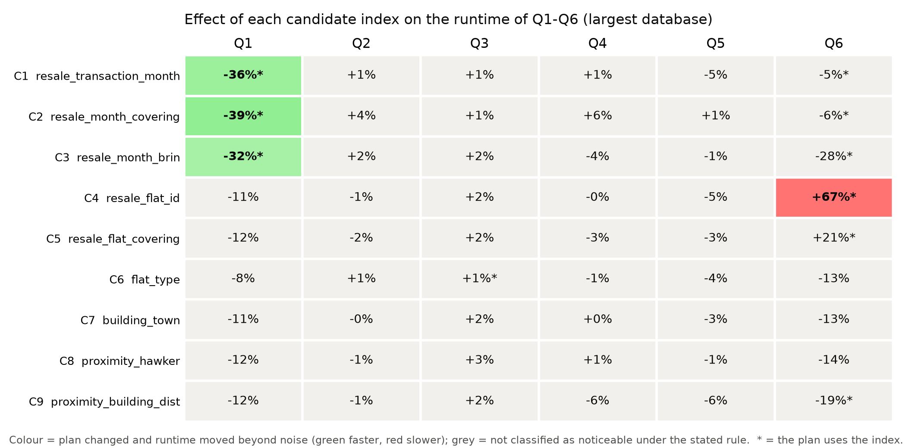
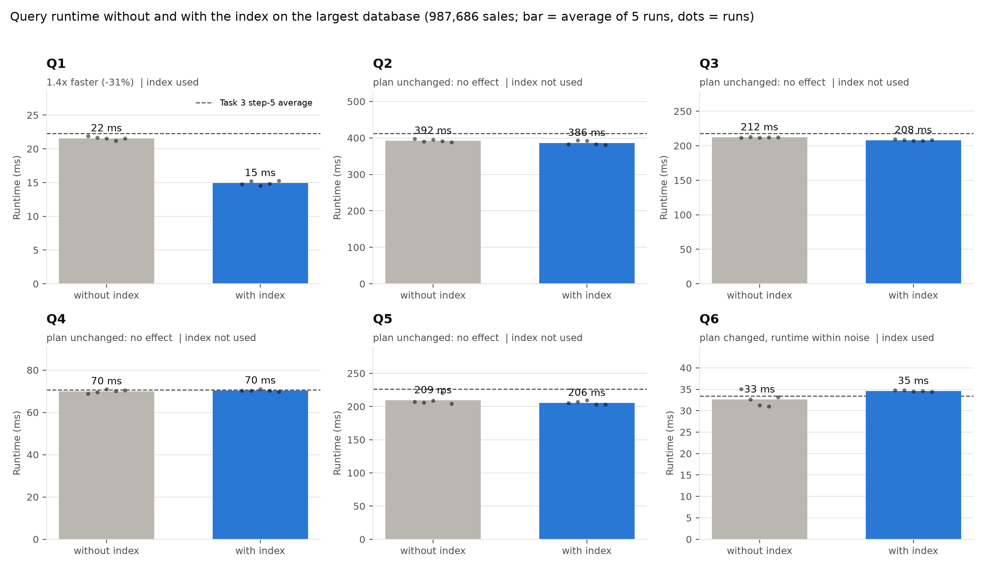

# Task 4 findings

## Setup

All measurements use the largest database (step 5: 987,686 sales from 1990-01 to 2026-09, 130.7 MB) and the six queries of Task 3 (`Task 3/queries.sql`, unchanged). Machine: PostgreSQL 18.4 (Postgres.app) on macOS (arm64), 10 CPUs, default settings (`shared_buffers` 128 MB, `work_mem` 4 MB, 2 parallel workers per query, JIT on).

Method:

- Each query is timed like in Task 3: wall-clock time from sending the query until all rows have arrived.
- One untimed warm-up run, then 5 timed runs, per query and condition.
- Statistics are refreshed with `VACUUM (ANALYZE)` on all seven tables before measuring, and with `ANALYZE` after every index is created.
- "Without" and "with" index are measured in the same session. The un-indexed averages are 0.90 to 0.99 times the Task 3 step-5 averages, so both sets of numbers agree.
- Every query returns exactly the same rows with and without an index (checked with a hash of the result in every run).
- A change counts as **noticeable** only if both hold: the `EXPLAIN` plan changed, and the average moved by more than 10% and by more than 2 standard deviations of the un-indexed runs. If the plan is identical, the index plays no part in the query, and any difference is run-to-run noise.

## 1. How the queries read the data

Before any new index, the schema only has the 13 indexes PostgreSQL creates for primary keys, unique constraints and the exclusion constraint. None is on `transaction_month` or on `resale_transaction.flat_id`. `EXPLAIN (ANALYZE, BUFFERS)` shows how each query reads the fact table `resale_transaction`:

| Query | Scan of `resale_transaction` | Rows kept | Rows thrown away |
|---|---|---|---|
| Q1 | Parallel Seq Scan, filter on `transaction_month` | 80,306 (8.1%) | 907,380 |
| Q2 | Parallel Seq Scan | 987,686 (100%) | 0 |
| Q3 | Seq Scan | 987,686 (100%) | 0 |
| Q4 | Parallel Seq Scan | 987,686 (100%) | 0 |
| Q5 | Seq Scan | 987,686 (100%) | 0 |
| Q6 | Parallel Seq Scan, filter on `transaction_month` | 80,306 (8.1%) | 907,380 |

Insight: Only Q1 and Q6 filter the fact table (sales of 2022-2024) and throw away 92% of the rows they read. That is the case an index can help. Q2 to Q5 need every sale, so an index has nothing to skip.

## 2. Initial four-index configuration

We first created four indexes from the table structure and the joins of the queries:

| # | Index | Reason for testing |
|---|---|---|
| 1 | `resale_transaction(transaction_month)` | Q1 filters to 2022-2024; locate the date range instead of scanning every sale |
| 2 | `resale_transaction(flat_id)` | join column of every query (transaction to flat) |
| 3 | `hdb_flat(building_id)` | join from flats to buildings |
| 4 | `proximity(building_id, distance_m)` | nearest hawker centre per building (`MIN(distance_m)`) in Q4 and Q5 |

Five Q1 runs, compared with the Task 3 baseline (transcribed from `Task4_Q1_Index_Benchmark_Log.xlsx`, not newly measured):

| Run | Task 3 baseline (ms) | Four indexes (ms) |
|---|---|---|
| 1 | 22.308 | 38.135 |
| 2 | 22.013 | 39.678 |
| 3 | 22.363 | 39.433 |
| 4 | 22.141 | 39.992 |
| 5 | 22.560 | 38.692 |
| Average | 22.277 | 39.186 |

Q1 was 75.9% slower with the four indexes, so we dropped the plan of adding indexes on every join column and tested candidates one by one instead (section 3).

What this measurement can and cannot show:

- It measures the four indexes **together**; it does not show which one slowed Q1, or whether any did.
- The baseline is historical (Task 3), taken under possibly different conditions, and only Q1 was timed.
- The later tests did not reproduce the slowdown: index 1 alone (C1) made Q1 29.4% faster, and the combinations C1+C4 and C1 plus five more indexes (which include close equivalents of indexes 2 and 4) gave Q1 at 14.5 to 14.8 ms. Index 3 was not tested again, so the cause of the first result is **not established**.
- Index 3 was probably redundant anyway: the unique constraint `flat_profile_unique` on `hdb_flat` already starts with `building_id`.

## 3. Candidate screening: nine indexes, one at a time

Protocol for each candidate: create it, `ANALYZE`, record whether the plan changed and uses the index, run Q1 to Q6 (1 warm-up + 5 runs each), drop it. The un-indexed baseline is measured before the first and after the last candidate (10 runs per query, pooled from BASELINE_START and BASELINE_END in task4_candidate_screening.csv: Q1 23.68 ± 2.82 ms, Q2 399.50 ± 13.25, Q3 210.39 ± 2.59, Q4 73.28 ± 3.96, Q5 216.36 ± 20.70, Q6 36.61 ± 6.68).

| ID | Index | Why we tried it | Size (MB) | Build (ms) | Q1 | Q6 | Q2-Q5 | Verdict |
|---|---|---|---|---|---|---|---|---|
| C1 | `resale_transaction(transaction_month)` | date filter of Q1, Q6 | 6.73 | 130.1 | **-35.8%** | -4.9% (noise) | none | **kept** |
| C2 | same, `INCLUDE (flat_id, resale_price)` | covering: index-only scan possible | 29.73 | 409.4 | **-39.3%** | -5.7% (noise) | none | rejected: about 0.85 ms more gain on Q1 at 4.4 times the size |
| C3 | `resale_transaction USING brin (transaction_month)` | same filter, tiny | 0.02 | 23.8 | **-31.8%** | **-27.7%** | none | best measured for Q6; not submitted (section 4) |
| C4 | `resale_transaction(flat_id)` | foreign key, join column | 9.72 | 202.0 | -11.2% (not beyond noise) | **+66.6% (slower)** | none | rejected |
| C5 | `resale_transaction(flat_id) INCLUDE (transaction_month, resale_price)` | covering version of C4 | 29.73 | 495.0 | -12.2% (not beyond noise) | **+21.0% (slower)** | none | rejected |
| C6 | `hdb_flat(flat_type)` | equality filter in Q1, Q3, Q6 | 0.99 | 30 | noise | noise | none | rejected: no effect |
| C7 | `hdb_building(town_id)` | foreign key | 0.09 | 1 | noise | noise | none | rejected: no effect |
| C8 | `proximity(hawker_id)` | foreign key; primary key starts with `building_id` | 0.23 | 5 | noise | noise | none | rejected: no effect |
| C9 | `proximity(building_id, distance_m, hawker_id)` | `MIN` per building (Q4, Q5), `DISTINCT ON` (Q6) | 0.95 | 4 | noise | -19.2% (noise) | none | rejected: no effect |

"noise" means the plan did not change or the change is inside the noise rule. For Q2 to Q5, candidate changes ranged from -6.1% to +5.8%, and none of those changes was noticeable.



Insight: Only candidates on `transaction_month` helped, and only Q1 and Q6. The `flat_id` indexes (C4, C5) were used by the planner and made Q6 much slower. We did not examine the plan; a likely reason is that a join through an index on a randomly ordered column costs more than a hash join over the whole table. The small tables (C7 to C9) are always read faster in full, so their indexes change nothing.

The screening was run four times while we developed the notebook, and the pattern was the same each time: C4 on Q6 +84% to +89%, BRIN on Q6 -16% to -22%, B-tree on Q1 -29% to -31% in the final measurement. The saved files are from the last run.

Combinations (average ms over 5 runs; baseline = pooled un-indexed runs):

| Set | Q1 | Q2 | Q3 | Q4 | Q5 | Q6 |
|---|---|---|---|---|---|---|
| baseline | 23.7 | 399.5 | 210.4 | 73.3 | 216.4 | 36.6 |
| C1 | 16.7 | 408.6 | 274.0 | 74.4 | 230.9 | 36.5 |
| C1 + C6 | 14.8 | 416.4 | 207.7 | 68.7 | 206.7 | 34.5 |
| C1 + C4 | 14.5 | 384.8 | 211.1 | 70.6 | 206.2 | 34.7 |
| C1 + C4, C6, C7, C8, C9 | 14.7 | 389.8 | 208.4 | 70.2 | 212.3 | 32.2 |

Adding indexes to C1 does not make Q1 any faster or help Q2 to Q5. Only Q6 is back near its baseline (32.2 ms) with all five extra indexes; we did not investigate why, and it does not justify five more indexes.

## 4. Final index

```sql
CREATE INDEX idx_resale_transaction_month
    ON housing.resale_transaction (transaction_month);

ANALYZE housing.resale_transaction;
```

(also in `indexes.sql`)

Why this index: Q1 and Q6 keep only 8.1% of the sales (2022-2024) and the plan reads and discards the other 92%. With the index PostgreSQL reads only the matching rows. It is the only candidate that helped a query without hurting another one badly.

Why a plain B-tree and not the alternatives:

- A B-tree does not depend on how the rows are stored. A BRIN index only skips table pages when the dates follow the physical order of the table. Here that order comes from the order of the loaded CSV files and is not guaranteed by the schema.
- The covering B-tree (C2) gave about 0.85 ms more on Q1 (14.36 against 15.21 ms) at 4.4 times the size.
- **Trade-off we accept:** BRIN was smaller (0.02 MB) and also made Q6 27.7% faster, while the B-tree makes Q6 about 6.1% slower. The B-tree was chosen for robustness, not because it was the fastest option we measured. The screening does not show that it is faster than BRIN.

## 5. Results: with and without the index

Average of 5 runs ± standard deviation, in ms, from `indexes.sql` created on the same database:

| Query | Without index | With index | Change | Index used by the plan |
|---|---|---|---|---|
| Q1 | 21.56 ± 0.25 | 14.93 ± 0.32 | **−30.8% (1.44 times faster)** | yes |
| Q2 | 392.17 ± 3.93 | 386.40 ± 5.59 | No noticeable effect (plan unchanged) | no |
| Q3 | 212.18 ± 0.48 | 208.10 ± 0.89 | No noticeable effect (plan unchanged) | no |
| Q4 | 69.97 ± 0.80 | 70.32 ± 0.49 | No noticeable effect (plan unchanged) | no |
| Q5 | 209.47 ± 6.36 | 205.62 ± 2.69 | No noticeable effect (plan unchanged) | no |
| Q6 | 32.62 ± 1.64 | 34.61 ± 0.15 | **+6.1% slower (1.99 ms)** | yes |



The dashed line in each panel is the Task 3 step-5 average (Q1 22.28, Q2 412.19, Q3 217.83, Q4 70.58, Q5 226.61, Q6 33.47 ms).

Discussion:

### Discussion

- **Q1 (−6.63 ms).** The plan changes from a Parallel Seq Scan that reads 987,686 rows to a Parallel Bitmap Heap Scan fed by a Bitmap Index Scan that returns exactly the 80,306 matching rows. The average runtime decreases from 21.56 ms to 14.93 ms, a 30.8% reduction (approximately 1.44 times faster). The gain is limited because the rest of the query (scan of the 4- and 5-room flats, joins to buildings and towns) is unchanged, and because Q1 was already relatively fast: the parallel scan of the sales table is cheap.

- **Q6 (+1.99 ms).** PostgreSQL chose the index plan because it estimated it cheaper, but the measured average runtime is higher, increasing from 32.62 ms to 34.61 ms (+6.1%). The slowdown is small and falls below the 10% threshold used to classify noticeable runtime changes. The observed runtime ranges overlap, so the new measurements do not establish that every indexed run was slower than every non-indexed run. We did not isolate the cause.

- **Q2 to Q5.** The plans are identical with and without the index, so the index plays no part in these queries. The average runtime differences range from −1.9% to +0.5%, and are classified as not noticeable. These queries read every sale (Section 1).

Q5 returns 2 rows at step 5 in every measurement, so the budget of SGD 450,000 still gives a non-empty result on the largest database.

## 6. What indexes cannot fix

Task 3 named Q2 and Q3 as the first candidates for indexes. No index helps them (section 3). Two experiments with session settings only (no schema change, `queries.sql` untouched) show where their time goes:

| Experiment | Before (ms) | After (ms) | Change |
|---|---|---|---|
| Q2 with `work_mem = 256MB` (removes the 15,648 kB disk spill of its sort) | 417.0 | 356.4 | -14.5% |
| Q3 with its `WITH three_room` subquery declared `NOT MATERIALIZED` (same result) | 210.2 | 109.9 | **-47.7%** |

Insight: The sort spill explains only part of Q2’s runtime; in these measurements, raising work_mem reduces the mean from 417.0 to 356.4 ms (-14.5%). Q3 gets about 1.9 times as fast from a rewrite, not from an index. We did not change queries.sql, because it is a Task 3 deliverable, but this is the largest speed-up we found.

## 7. Cost of the index

| Item | Value |
|---|---|
| Size of `idx_resale_transaction_month` | 6.73 MB (13.7% of the 49.1 MB table) |
| Build time (create + `ANALYZE`) | 148.4 ms |
| Inserting 100,000 sales into a copy of the table, without index | 203.0 ms |
| The same insert with the index | 288.9 ms, **+42.4%** |

Insight: The index makes inserts slower and takes space. The insert slowdown in the saved cost measurement is +42.4%. The database is only read after loading, so this cost is acceptable here.

## 8. Limitations

- One database size (the largest), one machine, 5 runs per condition. The benefit of an index depends on the hardware: Q1 was already about 21 ms here because the sales table is scanned in parallel, which leaves little to save.
- The data mostly fits in memory (the housing tables with their indexes are 122.6 MB, `shared_buffers` is 128 MB, and the operating system also caches files), and one warm-up run precedes the timed runs. Runs with a cold cache were not measured.
- The workload is read-only analysis. The insert cost matters little here, but would in a system that keeps receiving sales.
- The initial four-index measurement is Q1 only, uses a historical baseline, and cannot be attributed to a single index (section 2).
- The noise rule is a rule of thumb (10% and 2 standard deviations), and Q6's measured slowdown is below the 10% threshold.

## 9. Discrepancies and how we handled them

- **Stale statistics right after loading.** Q4 and Q5 ran in 125 ms and 370 ms, against 70.6 ms and 226.6 ms in Task 3. After `VACUUM (ANALYZE)` on all seven tables they matched (69.5 and 198.9 ms). All measurements here are taken after refreshing the statistics.
- **PostgreSQL 18 prints fractional row counts** in `EXPLAIN ANALYZE` (for example `rows=26768.67`). The notebook's plan parser expected whole numbers and failed, so it was changed to accept decimals.
- **A disturbed baseline.** In one screening run the first Q1 baseline block was 31 ms instead of about 22 ms, which inflated the noise estimate and hid a real effect in the table. We repeated the run; the two baselines then agreed (23 and 22 ms for Q1), and the results here come from that run.
- **Q6 is below the 10% threshold** in the final measurement, so the table classifies its +6.1% slowdown as not noticeable. The raw final runs overlap (without index: 31.023–35.093 ms; with index: 34.406–34.755 ms), and do not support the earlier statement about five non-overlapping runs.
- **The initial four-index slowdown was not reproduced** by the later tests (section 2).
- **Insert test**: three runs per condition, with a wide spread (section 7).

## Supplementary files

| File | Content |
|---|---|
| `indexes.sql` | The final `CREATE INDEX` statement, with the reasoning |
| `Task 4 Index Experiments.ipynb` | The notebook that produced every number in this report |
| `results/task4_measurements.csv` | Raw measurements: 60 rows (6 queries x 5 runs x with/without index) |
| `results/task4_summary.csv` | Average, standard deviation, min and max per query, with and without the index |
| `results/task4_runtime_with_vs_without_index.png` | The bar chart of section 5 |
| `results/task4_candidate_screening.csv` | Raw screening: 330 rows (9 candidates and two baselines, 6 queries x 5 runs) |
| `results/task4_candidate_summary.csv`, `results/task4_candidate_screening.png` | Summary and heat map of the screening |
| `results/task4_combination_tests.csv` | Candidates in combination |
| `results/task4_index_cost.csv` | Size, build time and insert slowdown |
| `results/task4_supporting_experiments.csv` | Q2 `work_mem` and Q3 `NOT MATERIALIZED` runs |
| `results/task4_environment.json` | PostgreSQL version, CPU count and settings of the measuring machine |
| `results/plans/` | `EXPLAIN ANALYZE` of every query without and with the index |

